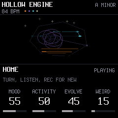

# After Images

A generative synth for the M-VAVE FM-1. Press REC and it makes a new piece of ambient music that keeps evolving:
four layers, each its own sequencer driving its own sound in its own part of the spectrum, listening to each other.
Musical (everything is locked to the scale), but it can go somewhere strange.

By [TheGrizard](https://github.com/TheGrizard). Built on [fm1-base](https://github.com/charlesvestal/fm1-base) (MPL-2.0)
and felucca-bsp. Works on both FM-1 flash chips.

## The four layers

| Layer | Band | Its part |
|---|---|---|
| GROUND | sub and bass, ~30-200 Hz | the root, its fifth and octave: the floor |
| BODY | low mids, ~150 Hz-1 kHz | the chords (Detroit voicings when MOOD is up) |
| LIGHT | mids, ~500 Hz-4 kHz | the melody |
| DUST | highs, ~2-12 kHz | the air: specks, chimes, breath |

Each piece gives every layer one of ten **sequencers**, shuffled: EUCLID (Euclidean rings), TURING (a looping shift
register that flips bits), MARKOV (a table of chances), LORENZ (the attractor: a note at each loop's peak), BOUNCE
(bouncing balls), ORBITS (planets with different years), LIFE (a cellular automaton), CHIMES (wind chimes in gusts),
PHASE (one phrase on two players drifting apart, Steve Reich's way) and DRUNK (a Brownian walk). And one of ten
**engines**: DRIFT SAW, FM, STRING, BELL, BLEEP, GLASS, BREATH, VOICE, FOLD and SUB. Every piece has at least one
heavy layer and one soft one. A piece is a seed: the same piece always starts the same way.

LINK makes the layers answer each other: a note in one nudges another's system (a ball dropped, a bit flipped, the
attractor kicked) and now and then moves the harmony on. A heavy GROUND note ducks BODY and DUST, so the low end
stays clear.

## Playing it

| Control | What it does |
|---|---|
| K1 to K4 | the page's four macros (the one you turn shows big) |
| HOME | MOOD (dark to bright, triads to ninths), ACTIVITY, EVOLVE (how much the form changes), WEIRD |
| EDIT | SOUND for the chosen layer: ENGINE, TONE, WEIGHT (soft to heavy), WEIRD |
| SEQ | SEQUENCE for the chosen layer: TYPE, DENSITY, RATE, MUTATE |
| ENV | MIX for the chosen layer: LEVEL, ATTACK, RELEASE, OCTAVE |
| FX | EFFECTS: REVERB, ECHO (tempo-locked, tape wobble), GRAIN (turned right up: freeze), SHIMMER |
| LFO | MOTION: LINK, WARP (swing and phrases that speed up and slow down), DRIFT, CHAOS (ratchets, skips) |
| GLO | SCALE: KEY, SCALE (20 of them), CHORDS (the black keys'), TEMPO |
| ARP | MIDI: MIDI OUT on or off, CHANNEL (the layers on four in a row), KEYS CH, CLOCK out |
| SELECT, or tap SEL | the layer the SOUND, SEQUENCE and MIX pages and the keys play |
| PRESET | the chosen layer's engine |
| REC | a new piece (your key, scale and tempo kept) |
| REC held | a new world: a new key, scale and tempo too |
| SEL held + REC | the chosen layer anew: a new sequencer and sound |
| OCT- / OCT+ | back and forward through the pieces REC replaced |
| SAVE | keep the piece (up to 16); ALGORITHM steps through them |
| PLAY | stop and start (it fades) |
| HOME tapped on HOME | the processor's load and whether saving works |
| white keys | the scale's notes, up from the key, on the chosen layer's sound: no wrong notes |
| black keys | the scale's chords: I to VII, then I to IV an octave up (CHORDS sets triads, sevenths, ninths, sus, spread, fifths) |

The piece playing is kept by itself a few seconds after your last change, so the FM-1 comes back where you left it.

MIDI out (USB): each layer's notes on its own channel (1-4 by default), the keys on another (5), clock if you want it.
MIDI in: notes play the chosen layer, put into the scale; CC 20-23 are HOME's macros, 24-27 EFFECTS', 28-31 MOTION's.

## Building it

    git clone --recursive https://github.com/TheGrizard/After-Images
    cd After-Images
    base/tools/setup_toolchain.sh        # JieLi's compiler and the AC79 SDK's three files, checked against a lock
    ./build.sh                           # app/build/after-images.fwsc

Install it with the FM-1 plugged in by USB (needs `pip install mido python-rtmidi`; on Windows, Python 3.12):

    python3 base/tools/fm1_install.py app/build/after-images.fwsc

Or from a release: download the `.fwsc` and run `py -V:3.12 fm1_install.py after-images-X.Y.fwsc`, or use the
[web installer](https://TheGrizard.github.io/After-Images/install/).

### On the computer first

    ./build.sh --host
    tests/run_tests.sh                   # the simulator's checks: pages, REC, saving, the keys, the screen reader
    make -C app/tools && app/tools/render 1234 120 piece.wav all    # a piece to a WAV, without the screen

### Releases

Pushing a tag such as `v0.1` builds the release on GitHub (`.github/workflows/release.yml`, the FM-1 builder shared
by fm1-base's firmwares), runs the tests and signs the packages.

## Inspiration

Cyma Forma's RND (one button, four layers, a new idea each press), Mutable Instruments' modules, and Autechre's way
of working: systems of rules rather than dice, layers that trigger each other, rhythm without obvious anchors, and
emotional chords under the strangeness. No code from any of them is in here.

## Licence

MPL-2.0. See fm1-base's LICENSING.md for the parts it is built from. M-VAVE and FM-1 are trademarks of their owners;
After Images is not affiliated with M-VAVE.
