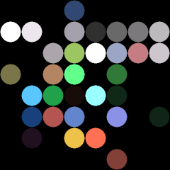
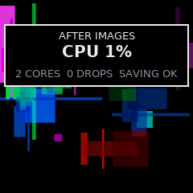
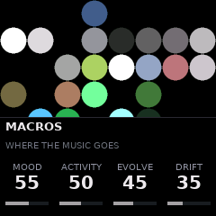
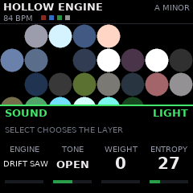
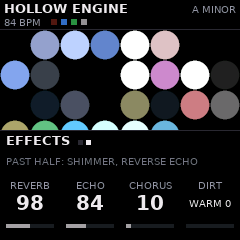
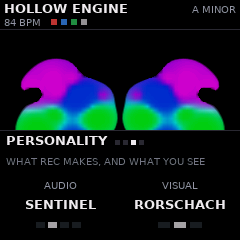
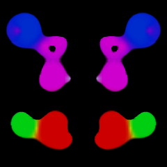
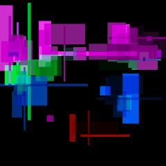

# User guide

After Images turns the M-VAVE FM-1 into a generative ambient composer. You don't program it note by note: you press
REC and it writes a piece, then you steer it. This guide starts with a quick reference and the first five minutes, then works out to the details.

## Contents

1. Quick reference
2. Installing
3. The first five minutes
4. The screen
5. The four layers
6. Steering a piece: the macros
7. Shaping a layer
8. The sounds
9. The sequencers
10. Effects
11. Motion and warble
12. Key, scale and tempo
13. Personality and the visuals
14. Playing the keys
15. Saving your pieces
16. MIDI, sync and recording
17. Ideas to try
18. When something's not right
19. Making music with it

---

## 1. Quick reference

| Control | What it does |
|---|---|
| K1 to K4 at home | the four layers' levels |
| HOME held + K1 to K4 | MOOD, ACTIVITY, EVOLVE, DRIFT |
| HOME tapped at home | the FM-1's health: CPU, drops, saving |
| HOME elsewhere | back home |
| REC | a new piece, following on from the last |
| REC held | a new piece in the same key and scale |
| SEL held + REC | the chosen layer dealt afresh |
| OCT- / OCT+ | the keys' octave down or up; on a GLO page, back and forward through the pieces REC replaced |
| SAVE | keep the piece |
| ALGORITHM knob | step through saved pieces |
| PLAY | stop (it fades out) and start |
| SEL, or SELECT knob | choose the layer |
| PRESET knob | the chosen layer's engine |
| EDIT | SOUND |
| SEQ | SEQUENCE |
| ENV, ENV again | MIX, VOICE |
| FX, FX again | SENDS, EFFECTS |
| LFO, LFO again | MOTION, WARBLE |
| GLO, twice, three, four times | MACROS, SCALE, PERSONALITY, SCREEN |
| ARP, twice, three times | MIDI, CHANNELS, USB AUDIO |
| white keys | the scale's notes |
| black keys | the scale's chords |

## 2. Installing

You need a computer with **Chrome or Edge** and a USB cable for the FM-1.

1. Open the [installer](../install/) and plug in the FM-1.
2. Follow the page. It takes about a minute, and the FM-1 restarts into After Images.

After Images is unofficial and not affiliated with M-VAVE: you install it at your own risk. The same installer can put
M-VAVE's own firmware back at any time, and you can go back to any earlier version of After Images from the
[releases](https://github.com/TheGrizard/After-Images/releases). Want to hear it first? [Play it in your browser](../emu/).

## 3. The first five minutes

1. **Listen.** It starts playing straight away.
2. **Turn K1 to K4** to set the four layers' levels: GROUND, BODY, LIGHT and DUST. The levels show while you turn.
3. **Press REC** for a new piece. Each one has its own key, tempo, sounds, sequencers, effects, colours and name, and
   it follows on from the last one round the circle of fifths.
4. **Hold REC** (about a second) for a new piece in the same key and scale.
5. **Hold HOME and turn K1 to K4** to steer the piece: MOOD, ACTIVITY, EVOLVE and DRIFT.
6. **Liked an earlier piece?** Press GLO, then OCT- to step back through the pieces REC replaced, OCT+ forward again.
7. **Press SAVE** to keep a piece. Turn the ALGORITHM knob to step through the ones you've saved.
8. **Stop with PLAY before you switch off,** and wait a few seconds. It keeps the piece and your settings by itself.

## 4. The screen

At home the screen shows the music as a visual (MATRIX, RORSCHACH or MOSH: see 13). On the other pages, the top shows
the piece's name, its tempo, its key and scale, and four small squares for the layers, lit as they play. The bottom
shows the page's four knobs: K1 to K4, left to right.

When you turn a knob at home, or change something with a button, a panel shows what changed and fades away.

**Tap HOME at home** for how the FM-1 is doing: how busy its processor is, how many times the audio has dropped out
since you switched on, and whether saving works.

## 5. The four layers

Every piece has four layers, each in its own part of the sound and its own colour:

| Layer | Colour | Its job |
|---|---|---|
| **GROUND** | red | the bass, and the loudest |
| **BODY** | blue | the chords and pads |
| **LIGHT** | green | the melody |
| **DUST** | white | the air: sparkle, texture, quiet details |

Each layer has its own sound and its own sequencer, and they listen to each other: one layer's notes can nudge another
layer's sequencer (LINK, in MOTION).

**Choosing a layer.** Tap **SEL** or turn the **SELECT** knob. The chosen layer is the one the SOUND, SEQUENCE, MIX,
VOICE and SENDS pages change, and the one the keys play. **Hold SEL and press REC** to deal the chosen layer afresh:
a new sound and sequencer, with the rest of the piece left alone.

## 6. Steering a piece: the macros

Hold **HOME** and turn the knobs, or press **GLO** for the same four as a page of their own:

- **K1, MOOD.** Darker to the left, brighter to the right, with 12 o'clock as REC dealt it. Darker brings in more sub
  bass and plainer chords (triads). Brighter opens the upper layers, colours the chords (sevenths, then ninths), and
  leaves GROUND carrying the bass alone.
- **K2, ACTIVITY.** How busy it is: from a few notes to many.
- **K3, EVOLVE.** How much the form changes: whole sections with layers dropping out and coming back, and new chords.
  At 0 it stays put.
- **K4, DRIFT.** The ambient mixer. Turned up, the layers fade in and out, wander round the stereo field, and slowly
  morph their sounds and effects, so the piece never settles. At 0 everything stays as you set it.

## 7. Shaping a layer

These pages change the chosen layer (see 5). Press a page's button to open it; press it again for its next page. The
dots beside the page's name show how many pages that button has, and which one you're on.

**EDIT: SOUND**

- **ENGINE** picks its sound (see 8). The **PRESET** knob does the same from any page.
- **TONE** works like a DJ's filter: 12 o'clock is open, left sweeps a low-pass down, right sweeps a high-pass up.
- **WEIGHT** goes from soft to heavy.
- **ENTROPY** adds strangeness. Up to halfway it's the engine's own; past it the synthesis turns on itself with chaos,
  feedback and slackness.

The knobs reach notes that are already sounding, so a long note changes as you turn.

**SEQ: SEQUENCE**

- **TYPE** picks the sequencer (see 9).
- **DENSITY** sets how many notes it plays.
- **RATE** sets how fast it runs against the tempo, from 1/4 to 3 times.
- **MUTATE** sets how much it changes as it goes.

**ENV: MIX**

- **LEVEL** sets the layer's volume, the same as K1 to K4 at home.
- **ATTACK** and **RELEASE** set how each note fades in and out. Even at zero, every note eases in over 2 ms and rings out for a moment, so nothing clicks or gets clipped off.
- **OCTAVE** moves the layer down or up by up to two octaves.

**ENV again: VOICE**

- **F.GLIDE** makes the filter glide after each new note (the pitch never slides).
- **LEGATO** makes overlapping notes run into each other instead of starting again.
- **SWEEP** opens a filter over each note.
- **RESO** sets the filter's resonance.

## 8. The sounds

Twenty-five engines. REC picks ones that suit each layer, but any layer can play any of them.

| Engine | What it is |
|---|---|
| **BLEEP** | a pulse wave, its width moving |
| **BOWL** | a singing bowl, rubbed or struck, its overtones beating |
| **BREATH** | noise through a tuned resonance: wind and breath |
| **CHOIR** | three voices singing from "ooh" to "aah" |
| **CZ** | 80s phase distortion, sine to saw to resonant sweeps |
| **DRIFT SAW** | two detuned saws, low-passed: the classic pad |
| **DX** | four-operator FM with a spectrum that moves over each note |
| **E.PIANO** | an 80s FM electric piano |
| **FM** | two-operator FM with feedback |
| **FOLD** | a sine folded back on itself |
| **GLASS** | four sine partials, bell-like |
| **MALLET** | a marimba, vibes or kalimba |
| **ORGAN** | drawbars with a rotating speaker's swirl |
| **REESE** | the jungle bass: two saws beating slowly, a deep low-pass, a sub underneath, long and legato |
| **SHAPES** | unusual waves that DRIFT moves through |
| **SINE** | pure; WEIGHT warms it |
| **SQUARE** | plain and warm |
| **STRING** | a plucked string; ENTROPY loosens it |
| **STRINGS** | an 80s string machine: soft, dark, wandering |
| **SUB** | a sine with its octave, driven: deep bass |
| **SYNC** | a hard-synced saw, sweeping down over each note |
| **TRIANGLE** | soft and round; WEIGHT folds it |
| **VHS SYNTH** | a saw and square drifting apart through a slow, dark filter, like an old synth on a worn tape |
| **VOICE** | a pulse through vowel formants |
| **WAVES** | a wavetable scanned from dark to bright as each note plays |

## 9. The sequencers

None of them roll dice. Each is a small system with rules, so its patterns have a shape you can hear.

| Sequencer | How it makes notes |
|---|---|
| **EUCLID** | hits spread evenly round a ring, a melody of another length over them |
| **TURING** | a looping pattern that sometimes flips a step |
| **MARKOV** | each note chosen from the last by learned chances |
| **LORENZ** | a note at each loop of the Lorenz attractor: never quite repeating |
| **BOUNCE** | bouncing balls, faster and softer as they settle |
| **ORBITS** | planets with their own years: a note as each comes round |
| **LIFE** | a row of cells growing by a rule; the live ones play |
| **CHIMES** | wind chimes knocked together by gusts |
| **PHASE** | one phrase played twice at slightly different speeds, drifting apart (Steve Reich) |
| **DRUNK** | a walk: each note a small step from the last |
| **MELODY** | a long, looping early-90s Warp melody that slowly changes |

## 10. Effects

Four shared effects. Each layer sends its own amount to each one, so GROUND can stay dry while LIGHT swims in echo.

- **FX** opens **SENDS**: how much of the chosen layer goes to each effect.
- **FX again** opens **EFFECTS**: the effects themselves, for the whole piece.

- **REVERB.** Up to 12 o'clock, a room from small to vast. Past it, a shimmer comes in an octave up, and by full an
  octave down as well.
- **ECHO.** Up to 12 o'clock, a tape echo locked to the tempo. Past it, the echo turns into a reversed, smeared wash.
- **CHORUS.** Up to 12 o'clock, a chorus from gentle to lush. Past it (shown as ENS), a slower, deeper, wider ensemble
  like an old string machine's.
- **DIRT.** Tape pushed hard, from warm saturation to fuzz to breakup with hiss and dropouts.

A layer's send always does something, even with the shared amount at 0. Shared CHORUS and DIRT also reach every layer
a little, even with its send at 0.

Each REC also **features** one effect: shimmer, reverse echo, chorus, ensemble, tape saturation, tape fuzz, wide space
or HAZE, never the same twice in a row. The panel after REC names it.

## 11. Motion and warble

**LFO: MOTION**

- **LINK** sets how much the layers answer each other.
- **WARP** adds swing, with phrases speeding up and slowing down.
- **FLOW** adds slow random movement to the filters.
- **CHAOS** adds ratchets and skipped steps.

**LFO again: WARBLE.** This puts worn tape inside the synth:

- **WARBLE** makes the pitch wander slowly.
- **FLUTTER** adds a faster wobble.
- **DETUNE** puts everything a touch flat.
- **WEAR** makes the whole mix sound like an old tape: duller and narrower, its top end drifting.

## 12. Key, scale and tempo

**GLO again: SCALE**

- **KEY** sets the root note.
- **SCALE** picks from 20 scales, from major and minor through the modes to pentatonics, Hirajoshi and whole tone.
- **CHORDS** sets the chord colour: triads, sevenths, ninths, suspended, spread or fifths.
- **TEMPO** sets the speed, from 40 to 180 BPM.

Every note stays in the scale, whatever you change.

When it follows a MIDI clock (see 16), TEMPO shows the clock's tempo, marked **IN**.

## 13. Personality and the visuals

**GLO three times: PERSONALITY.** KNOB 1, **AUDIO**, chooses what kind of piece REC makes. KNOB 3, **VISUAL**, chooses
what the screen shows.

The four personalities each favour their own sounds, sequencers, tempos, scales, effects and macro ranges:

- **ANALYST.** The original After Images: anything from drones to melodies, 65 to 110 BPM.
- **SENTINEL.** Dark, droning and fuzzy. Slow, sparse lines at 50 to 70 BPM on REESE, FOLD and noisy BREATH, everything
  through the fuzz, MOOD low.
- **DIPLOMAT.** Distant and ethereal. Slow pads (STRINGS, CHOIR, WAVES, SINE) at 45 to 65 BPM, long swells, deep in the
  shimmer reverb and the echo, the bass soft.
- **EXPLORER.** Analogue, melodic and moving, the synthwave side. Turing machine arpeggios and a bass line with a melody
  of its own, on DRIFT SAW, SQUARE and VHS SYNTH at 80 to 110 BPM, chorused and a little wobbly.

The personality takes effect at your next REC. With SENTINEL, DIPLOMAT or EXPLORER, REC also sets the HOME macros within
that personality's ranges (on ANALYST they stay as you left them). Everything is still yours to change afterwards.

**GLO a fourth time: SCREEN** sets up the visual. Each REC deals a new colour palette, and the four layers always keep
four clearly different colours.

- **MATRIX.** A pegboard of light. Each note lights a peg by its pitch and its place in the stereo field. Mixed colours breed between lit pegs and the old ones fade. SCREEN: **COUNT, SIZE, BREED,
  FADE**.
- **RORSCHACH.** A folded inkblot. Each layer's ink swells with the beat as it plays, the colours bleed together, and
  black voids carve through. SCREEN: **SIZE, GAPS, MIX, FADE**.
- **MOSH.** Blocks and lines that pile up, mix and stretch where the music sits in the stereo field. On the PERSONALITY
  page, **SHAPES** (KNOB 4) picks BLOCKS (squares, rectangles and lines) or LINES (mostly lines). SCREEN: **SIZE** (the zoom), **BREED,
  MOULD, FADE**.

When you stop, the visual fades to black. While stopped, the keys (and MIDI in) still draw on it, so you can watch your
sounds as you audition them. It fades again a few seconds after you stop playing.

 

## 14. Playing the keys

The keys play the chosen layer's sound, always in the scale, so there are no wrong notes.

- The **white keys** play the scale's notes.
- The **black keys** play its chords: I to VII, then I to IV an octave up.
- **OCT- and OCT+** move the keys down or up an octave at a time (three each way). The button stays lit while
  you're shifted. On a GLO page they step through earlier pieces instead.

Your notes ride along with the piece, through its effects.

## 15. Saving your pieces

- **SAVE** keeps the piece playing, in up to 16 places. Turn **ALGORITHM** to step through them.
- **Saving over a piece.** If the piece came from ALGORITHM, SAVE updates it in place. If it came from REC, SAVE adds
  a new one.
- **The SAVE light** stays lit while the piece has changes you haven't saved.
- **Saving by itself.** A few seconds after you stop with PLAY, it keeps the piece and all your settings. It never does
  this while the music plays, because writing to memory stops the audio for a moment. Nor while you're auditioning:
  it waits until you haven't played the keys (or MIDI in) for 8 seconds and the sound has died away. So **stop, and
  give it a few seconds, before switching off**. It never changes your SAVE slots.
- **SAVE while playing** also works: you'll hear a soft dip while it writes.

## 16. MIDI, sync and recording

**ARP: MIDI**

- **CLOCK** sets where the tempo comes from: **INT** (its own), **IN** (following another device's clock) or **OUT**
  (leading: sending its clock, start and stop).
- **NOTES OUT** sends every layer's notes, each on its own channel, and the notes you play, so you can double the
  piece on other synths. It doesn't affect the clock.
- **NOTES IN** decides what incoming notes play:
  - **LAYERS:** notes on a layer's channel play that layer; others play the chosen layer.
  - **CHOSEN:** every note plays the chosen layer.
  - **OFF:** incoming notes are ignored.
- **CC IN** lets other gear move the knobs. CC 20 to 23 move the macros (MOOD, ACTIVITY, EVOLVE, DRIFT), 24 to 27 the
  effects (REVERB, ECHO, CHORUS, DIRT), and 28 to 31 MOTION (LINK, WARP, FLOW, CHAOS).

**ARP again: CHANNELS** (the same channels in and out)

- **LAYERS** sets the four layers' channels: 1–4 by default, or any four in a row.
- **KEYS** sets the channel the notes you play go out on (5).
- **PLAY CH** sets which incoming channel plays the chosen layer. ANY means every channel that isn't a layer's.

Incoming notes are put into the scale. MIDI comes in over USB or the FM-1's TRS jack, and goes out over USB.

**Syncing to an Ableton Move.** Connect Move's USB-A port to the FM-1. On Move, set MIDI Sync to Out. On the FM-1, set
CLOCK (ARP) to IN. Press play on Move: the FM-1 starts with it, follows its tempo (the screen shows, say, 116 BPM IN), and
locks to its beats and bars. It stays locked through a new piece and a change of tempo.

**ARP a third time: USB AUDIO.** Plugged into a computer, the FM-1 shows up as a stereo audio input, so you can
record it straight into your DAW.

- **OUTPUT** sets what you hear and record. **MIX** is everything. **CLEAN** is the mix without effects: none of the
  FX page's four (reverb, echo, chorus, DIRT), nor the mix's balance or WEAR, so you can add your own when you mix.
  CLEAN changes the speaker and headphones too, because the computer records what the FM-1 plays.
- **LEVEL** sets how the computer's level is set. **VOLUME** follows the FM-1's volume knob, so turning it down turns
  the recording down too. **FIXED** ignores the volume knob and sends the level on **GAIN** (KNOB 4, shown only with
  FIXED): 0 to 100, starting at 80. 100 is full scale, where the peaks touch the top; 80 (about 4 dB down) leaves
  headroom for your DAW or AUM. With FIXED, GAIN turns the speaker and headphones down by the same amount, under the
  volume knob.

## 17. Ideas to try

- **A long drone for sleep or study.** Turn ACTIVITY down, MOOD a little left and DRIFT up. Set REVERB past 12
  o'clock for shimmer, then leave it.
- **VHS haze.** Press REC until the panel says HAZE, or set it up yourself: WARBLE up, DETUNE about
  halfway, WEAR around 50, CHORUS past 12 o'clock, and VHS SYNTH on BODY.
- **Jungle bass under ambient pads.** Put GROUND on REESE and turn LEGATO on (REC does both when it deals a REESE). Bring BODY's ECHO
  past 12 o'clock for the reverse wash.
- **A slowly evolving set.** Turn EVOLVE and DRIFT up, then hold REC every few minutes: each piece stays in key with the
  last, so a set flows on.
- **Play over it.** Choose LIGHT with SEL, pick MALLET or BOWL, and play the black keys for chords that always fit.
- **With a drum machine.** Sync to its clock (see 16). Turn WARP down so the sequencers stay on the grid, and CHAOS up a
  little for ratchets.

## 18. When something's not right

- **No sound.** Check the layer levels at home (K1 to K4) and the FM-1's volume, and that it's playing: the PLAY light
  is green.
- **Crackles or pops.** Tap HOME and look at DROPS. If it rises when you hear them, the FM-1 is running out of time: try
  fewer busy layers or less ACTIVITY. It also sheds notes by itself under heavy load.
- **A setting seems to do nothing.** Many settings act on the chosen layer: check which layer SEL has chosen (the page
  shows it in the layer's colour).
- **It didn't remember my changes.** It saves a few seconds after you stop with PLAY. Switching off while it plays
  loses what changed since the last save.
- **Not following the clock.** Check CLOCK (ARP) is set to IN, and that the other device sends clock as well as start and
  stop. The tempo shows "IN" while it follows.
- **Going back.** The [installer](../install/) can put M-VAVE's firmware back, or any earlier After Images from the
  [releases](https://github.com/TheGrizard/After-Images/releases).
- **Found a bug or have an idea?** [Open an issue](https://github.com/TheGrizard/After-Images/issues).

## 19. Making music with it

The music you make with After Images is yours: release it, sell it, use it however you like. If you do release
something made with it, a credit ("made with After Images") is appreciated, though never required.

To support After Images, have a listen to my label, [Burnt Ends Records on Bandcamp](https://burntendsrecords.bandcamp.com/).
