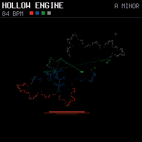

# After Images

A generative synth for the M-VAVE FM-1. Press REC for a new piece of ambient music that keeps evolving: four layers
(GROUND, BODY, LIGHT, DUST), each its own sequencer and sound in its own part of the spectrum, answering each other.
Everything is in the scale; WEIRD takes it somewhere strange.

**Version {{VERSION}}** (a test release) · **[Install it](install/)** · [Play it in your browser](emu/) ·
[Source](https://github.com/TheGrizard/After-Images)

## Installing

Open the [installer](install/) in Chrome or Edge on a computer, plug the FM-1 in by USB and follow the page. It
installs over M-VAVE's own firmware or another FM-1 firmware, on FM-1s with either flash chip, and can put M-VAVE's
firmware back. You install it at your own risk. Or [download {{PKG}}](firmware/{{PKG}}) for the command-line
installer: `python3 tools/fm1_install.py {{PKG}}`.

## Playing

| Control | What it does |
|---|---|
| K1 to K4 | at HOME the four layers' levels (shown while you turn); on the other pages, the page's four macros |
| HOME held + K1 to K4 | the macros: MOOD, ACTIVITY, EVOLVE, WEIRD |
| HOME, EDIT, SEQ, ENV, FX, LFO, GLO, ARP | the pages: HOME, SOUND, SEQUENCE, MIX, EFFECTS, MOTION, SCALE, MIDI; FX again: TAPE |
| SELECT, or tap SEL | the layer the SOUND, SEQUENCE and MIX pages and the keys play; PRESET its engine |
| REC | a new piece; held, a new key, scale and tempo too; SEL held + REC, the chosen layer anew |
| OCT- / OCT+ | back and forward through the pieces REC replaced |
| SAVE, ALGORITHM | keep the piece (up to 16), step through them |
| PLAY | stop and start |
| white keys | the scale's notes; black keys its chords |

MIDI out over USB: each layer on its own channel, the keys on another, clock if you want it.

Made by [TheGrizard](https://github.com/TheGrizard) on [fm1-base](https://github.com/charlesvestal/fm1-base) and
felucca-bsp. Free software under the MPL-2.0.

M-VAVE and FM-1 are trademarks of their owners. After Images is not affiliated with M-VAVE.
